<picture><source media="(prefers-color-scheme: dark)" srcset="assets/masthead-dark.svg">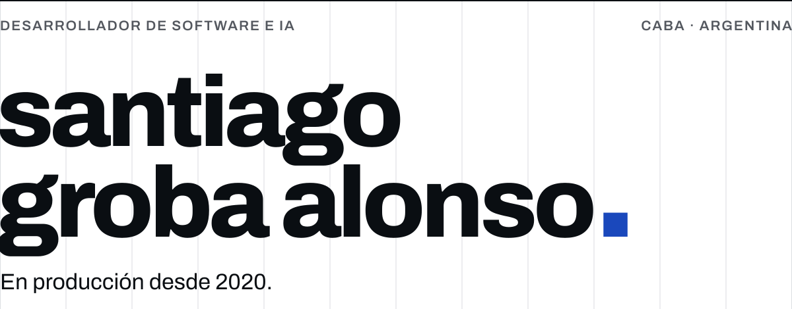</picture>

Ingeniería en IA en la UdeSA · sistemas en producción para escribanías y pymes · [LinkedIn](https://linkedin.com/in/santiago-groba)

  <a href="https://preciodeldolar.com.co"><picture><source media="(prefers-color-scheme: dark)" srcset="assets/poster-pdc-dark.svg">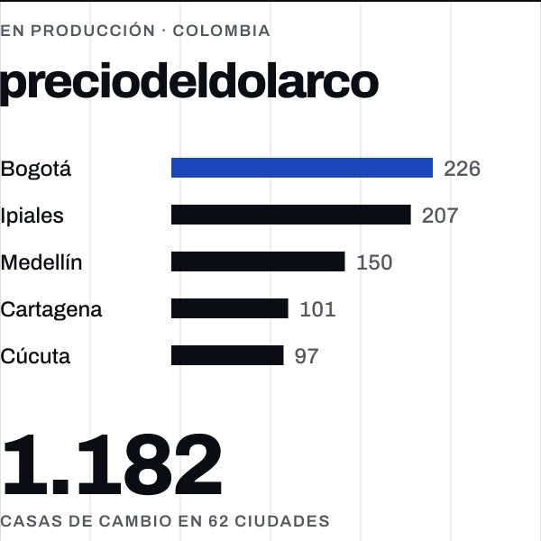</picture></a>
  <picture><source media="(prefers-color-scheme: dark)" srcset="assets/poster-llm-dark.svg"></picture>

  <a href="https://github.com/joacocullen/cot-compress"><picture><source media="(prefers-color-scheme: dark)" srcset="assets/poster-cot-dark.svg">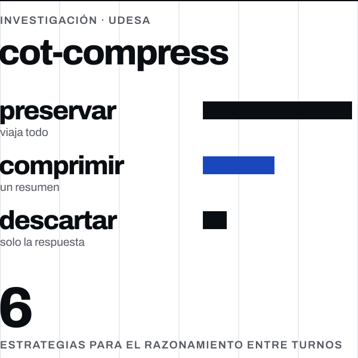</picture></a>
  <picture><source media="(prefers-color-scheme: dark)" srcset="assets/poster-infra-dark.svg">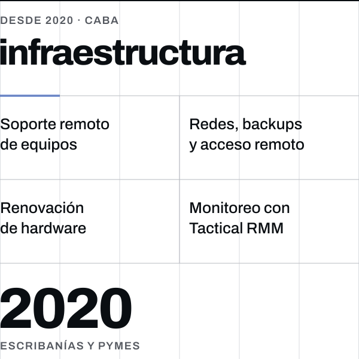</picture>

<a href="https://github.com/Santi2065?tab=repositories"><picture><source media="(prefers-color-scheme: dark)" srcset="assets/plate-dark.svg"></picture></a>

  <picture><source media="(prefers-color-scheme: dark)" srcset="assets/poster-derma-dark.svg">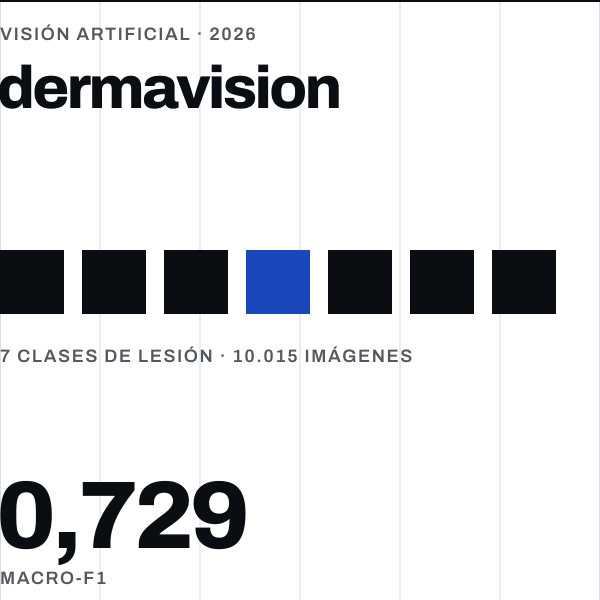</picture>
  <a href="https://github.com/Santi2065/stereo-3d-reconstruction"><picture><source media="(prefers-color-scheme: dark)" srcset="assets/poster-stereo-dark.svg">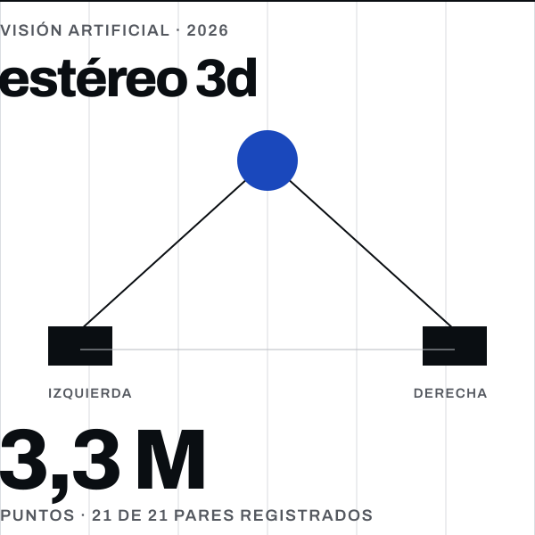</picture></a>

  <a href="https://github.com/Santi2065/hex-alpha-beta-agent"><picture><source media="(prefers-color-scheme: dark)" srcset="assets/poster-hex-dark.svg">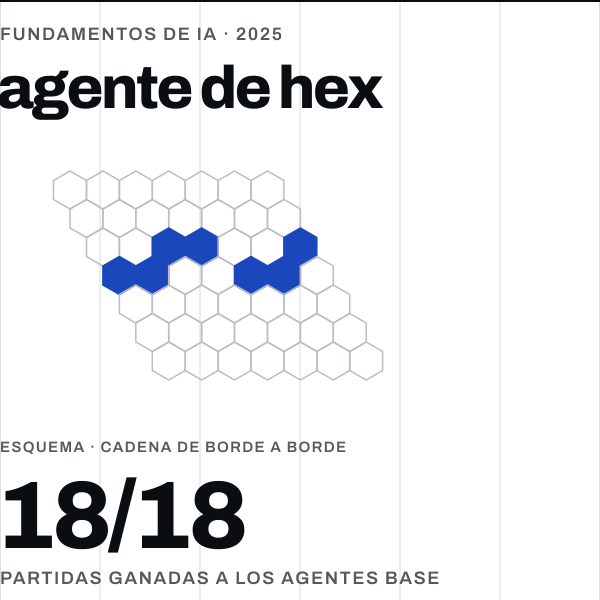</picture></a>
  <a href="https://github.com/Santi2065/armv8-simulator"><picture><source media="(prefers-color-scheme: dark)" srcset="assets/poster-arm-dark.svg">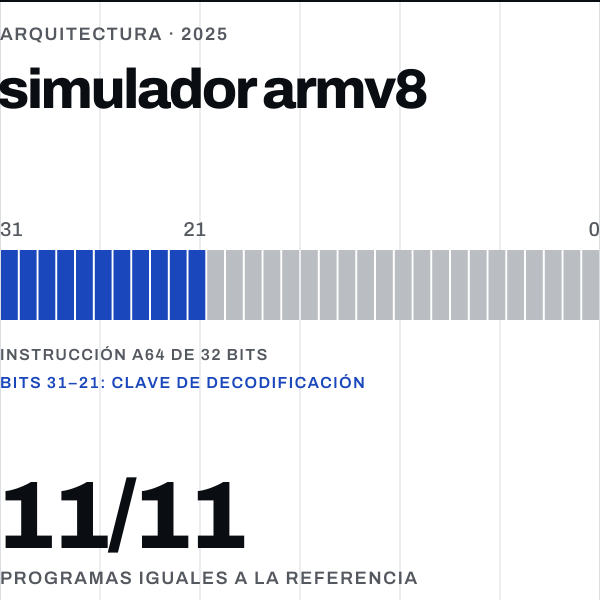</picture></a>

  <a href="https://github.com/Santi2065/unix-v6-filesystem"><picture><source media="(prefers-color-scheme: dark)" srcset="assets/poster-v6-dark.svg">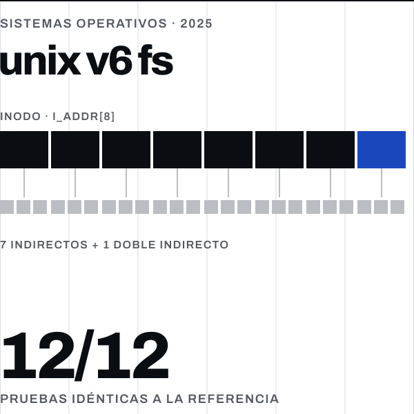</picture></a>
  <a href="https://github.com/joaco1212004/Ingenieria_de_Software---Groba-Salomon-Di_Cola"><picture><source media="(prefers-color-scheme: dark)" srcset="assets/poster-pozos-dark.svg">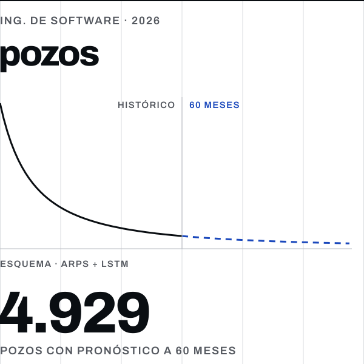</picture></a>

  <picture><source media="(prefers-color-scheme: dark)" srcset="assets/poster-clear-dark.svg">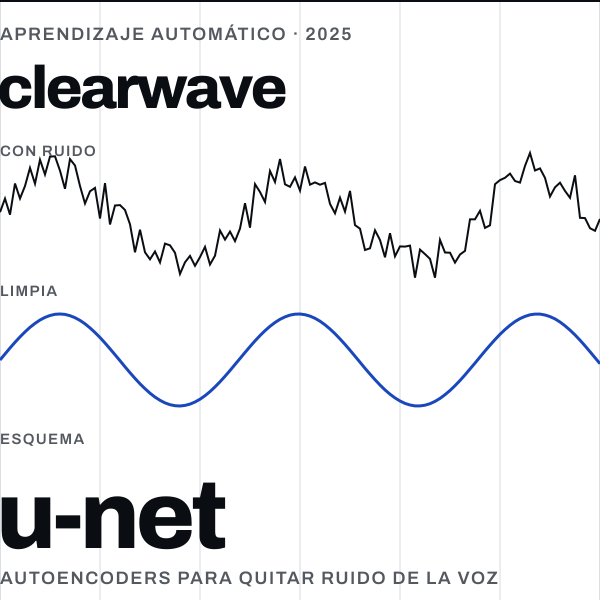</picture>
  <a href="https://github.com/Santi2065?tab=repositories"><picture><source media="(prefers-color-scheme: dark)" srcset="assets/poster-all-dark.svg">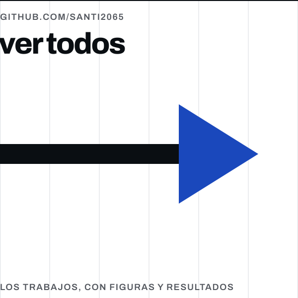</picture></a>

<picture><source media="(prefers-color-scheme: dark)" srcset="assets/tools-dark.svg"></picture>

Figuras con datos reales, generadas por [`scripts/build_profile.py`](scripts/build_profile.py).
