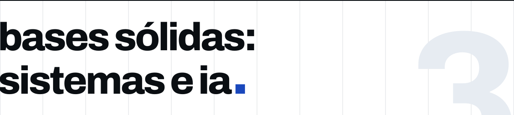

<picture><source media="(prefers-color-scheme: dark)" srcset="assets/masthead-dark.svg"></picture>

Ingeniería en IA en la UdeSA · [LinkedIn](https://linkedin.com/in/santiago-groba)

<picture><source media="(prefers-color-scheme: dark)" srcset="assets/head-1-dark.svg"></picture>

  <a href="https://preciodeldolar.com.co"><picture><source media="(prefers-color-scheme: dark)" srcset="assets/poster-pdc-dark.svg"></picture></a>
  <picture><source media="(prefers-color-scheme: dark)" srcset="assets/poster-infra-dark.svg"></picture>

<picture><source media="(prefers-color-scheme: dark)" srcset="assets/head-2-dark.svg"></picture>

  <picture><source media="(prefers-color-scheme: dark)" srcset="assets/poster-llm-dark.svg"></picture>
  <a href="https://github.com/joacocullen/cot-compress"><picture><source media="(prefers-color-scheme: dark)" srcset="assets/poster-cot-dark.svg"></picture></a>

<picture><source media="(prefers-color-scheme: dark)" srcset="assets/head-3-dark.svg"></picture>

<a href="https://github.com/Santi2065?tab=repositories"><picture><source media="(prefers-color-scheme: dark)" srcset="assets/plate-dark.svg"></picture></a>

<picture><source media="(prefers-color-scheme: dark)" srcset="assets/tools-dark.svg"></picture>

Figuras con datos reales, generadas por [`scripts/build_profile.py`](scripts/build_profile.py).
