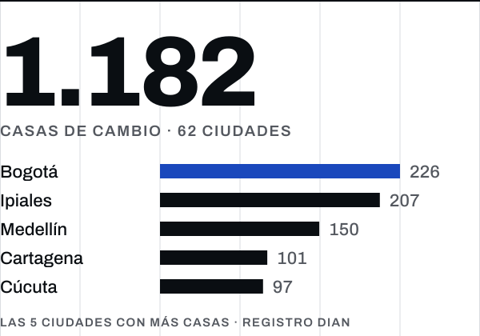
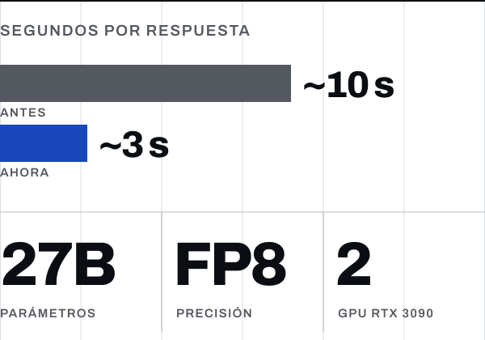
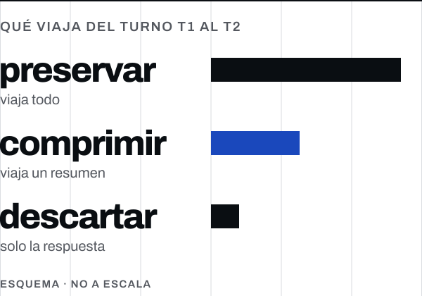
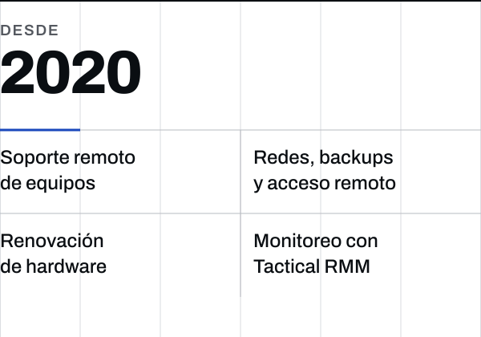

<picture>
  <source media="(prefers-color-scheme: dark)" srcset="assets/masthead-dark.svg">
  
</picture>

Soy **Santi**. Estudio Ingeniería en Inteligencia Artificial en la UdeSA y desde 2020 trabajo por mi cuenta para escribanías y pymes. Empecé administrando su infraestructura y hoy desarrollo y opero sistemas en producción: desde un comparador de 1.182 casas de cambio en Colombia hasta un LLM que vive en el servidor de una escribanía.

[LinkedIn](https://linkedin.com/in/santiago-groba) · [preciodeldolar.com.co](https://preciodeldolar.com.co) · CABA, Argentina · español, inglés y un poco de francés

## En qué trabajo

<a href="https://preciodeldolar.com.co"><picture><source media="(prefers-color-scheme: dark)" srcset="assets/proof-pdc-dark.svg"></picture></a>

### PrecioDelDolarCo

Comparador de tasas de cambio en Colombia, en producción en [preciodeldolar.com.co](https://preciodeldolar.com.co). Compara tasas de compra y venta y lista 1.182 casas de cambio en 62 ciudades.

- Scraper con 80 fuentes y 13 parsers
- Panel para dueños de casas de cambio, con planes pagos

`Next.js` · `PostgreSQL` · `Puppeteer`

 

<picture><source media="(prefers-color-scheme: dark)" srcset="assets/proof-llm-dark.svg"></picture>

### LLM on-premise

Para el archivo de escrituras de una escribanía: Qwen3.8 de 27B parámetros en FP8, sobre dos RTX 3090 y adentro de la oficina: los documentos y las consultas se procesan ahí. Cada respuesta tarda unos 3 segundos; antes tardaba unos 10.

`vLLM` · `Qdrant` · `PostgreSQL` · `RAG`

 

<a href="https://github.com/joacocullen/cot-compress"><picture><source media="(prefers-color-scheme: dark)" srcset="assets/proof-research-dark.svg"></picture></a>

### Investigación: CoT-Compress

¿Conviene preservar o descartar el razonamiento de un LLM entre turnos? Un chat local que comprime el razonamiento del modelo y lo reinyecta como memoria, con 6 estrategias de compresión y pruebas exploratorias propias sobre Terminal-Bench 2.0.

Dirigido por Juan Wisznia (UdeSA). Paper en preparación.

[joacocullen/cot-compress](https://github.com/joacocullen/cot-compress)

 

<picture><source media="(prefers-color-scheme: dark)" srcset="assets/proof-infra-dark.svg"></picture>

### Infraestructura

Escribanías y pymes de CABA, desde 2020. Ahí empecé: soporte remoto de equipos, redes, backups y acceso remoto, renovación de hardware y monitoreo con Tactical RMM.

 

<a href="https://github.com/Santi2065?tab=repositories"><picture><source media="(prefers-color-scheme: dark)" srcset="assets/plate-dark.svg"></picture></a>

## Facultad

Ingeniería en Inteligencia Artificial en la UdeSA. Los trabajos con repositorio tienen su README con figuras y resultados reproducibles.

| Trabajo | Qué es | Resultado |
|---|---|---|
| **DermaVision** Visión artificial · 2026 | Clasifica 7 tipos de lesiones de piel sobre 10.015 imágenes dermatoscópicas | 0,729 de macro-F1 |
| **[Estéreo&nbsp;3D](https://github.com/Santi2065/stereo-3d-reconstruction)** Visión artificial · 2026 | Reconstrucción 3D estéreo de una estatua de cerámica | 21 de 21 pares registrados, 3,3 M de puntos |
| **[Plataforma&nbsp;de&nbsp;pozos](https://github.com/joaco1212004/Ingenieria_de_Software---Groba-Salomon-Di_Cola)** Ingeniería de software · 2026 | Pronóstico a 60 meses de 4.929 pozos con un modelo Arps + LSTM | — |
| **ClearWave** Aprendizaje automático · 2025 | Elimina el ruido de la voz con autoencoders y una U-Net | — |
| **[Agente&nbsp;de&nbsp;Hex](https://github.com/Santi2065/hex-alpha-beta-agent)** Fundamentos de IA · 2025 | Agente de Hex con búsqueda alfa-beta y caminos mínimos (A*) | 18 de 18 partidas ganadas a los agentes base |
| **[Simulador&nbsp;ARMv8](https://github.com/Santi2065/armv8-simulator)** Arquitectura de computadoras · 2025 | Simulador funcional de ARMv8 (A64) en C | 11 de 11 programas iguales al simulador de referencia |
| **[File&nbsp;system&nbsp;V6](https://github.com/Santi2065/unix-v6-filesystem)** Sistemas operativos · 2025 | Lector del file system de Unix V6 en C | Salida idéntica a la de referencia en 12 de 12 pruebas |

[Ver todos los repositorios](https://github.com/Santi2065?tab=repositories)

## Herramientas

**Lenguajes** · Python · TypeScript · C · C++ · Java 
**IA y ML** · PyTorch · vLLM · llama.cpp · Ollama · Qdrant · MLflow 
**Datos** · PostgreSQL · dbt · Dagster 
**Web** · Next.js · React · FastAPI 
**Infra** · Docker · Linux · AWS · nginx · Prometheus · Grafana · GitHub Actions

Las figuras salen de datos reales y se generan con [`scripts/build_profile.py`](scripts/build_profile.py).
